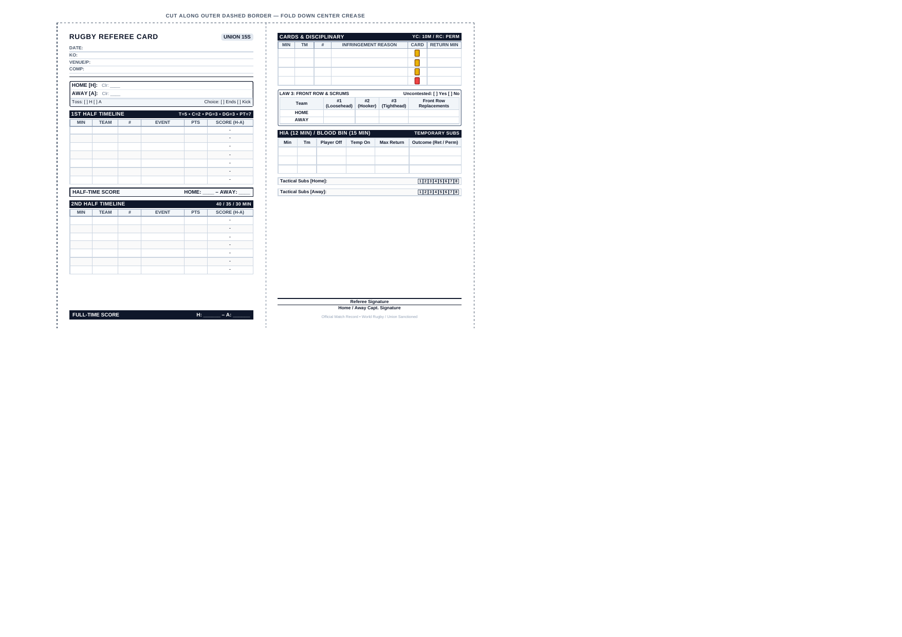
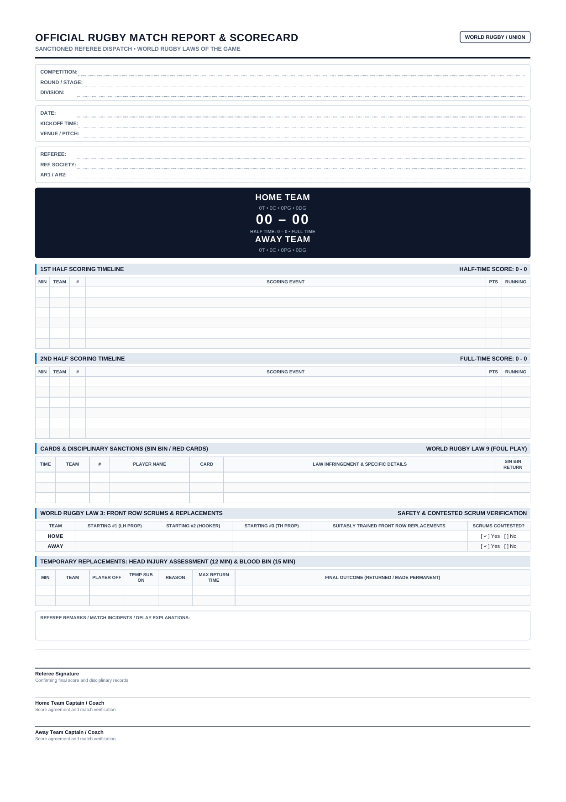

# Rugby Referee Scorecard & Match Companion Suite

A comprehensive, World Rugby Law–compliant match scoring and reporting suite designed specifically for rugby union and league match officials.

Includes:
1. **Printable Foldable Referee Pocket Scorecard** (`print-pocket-cards.html` & `pdfs/rugby_referee_pocket_card.pdf`): Sized to 86mm &times; 126mm (per panel), fitting perfectly into standard referee plastic wallets. Fold down the center crease for a double-sided, durable match card.
2. **Interactive Live Match Companion Web App** (`index.html`): Real-time clock with stoppage tracker, touch-friendly score buttons, conversion prompts, active sin-bin countdowns with audio/visual alerts, and one-tap WhatsApp / portal report copying.
3. **Official A4 / US Letter Match Report Sheet** (`print-match-sheet.html` & `pdfs/rugby_match_sheet.pdf`): Full audit sheet with scoring breakdown, disciplinary logs, Law 3 front row verification, HIA/blood bin tracking, and official sign-off boxes.

---

## Quick Navigation & Files

| Format / Tool | Interactive HTML | Ready-to-Print PDF | Description |
|---------------|------------------|--------------------|-------------|
| **Live Match App** | [index.html](index.html) | — | Live timer, touch scoring rack, sin-bin timers, WhatsApp export |
| **Foldable Pocket Card** | [print-pocket-cards.html](print-pocket-cards.html) | [pdfs/rugby_referee_pocket_card.pdf](pdfs/rugby_referee_pocket_card.pdf) | Standard 86mm &times; 126mm wallet size card (Front & Back) |
| **Official Match Sheet** | [print-match-sheet.html](print-match-sheet.html) | [pdfs/rugby_match_sheet.pdf](pdfs/rugby_match_sheet.pdf) | Full A4/US Letter match audit report and captain sign-off sheet |

---

## Previews

| Foldable Pocket Card (Wallet Size) | Official Match Report Sheet (A4 / Letter) |
|:---:|:---:|
|  |  |

---

## 1. Printable Pocket Card Instructions

### Dimensions & Setup
- **Panel Dimensions**: 86mm wide &times; 126mm high (folds down center crease to 86mm &times; 126mm).
- **Paper Recommendation**: 200–250 gsm cardstock or waterproof write-in-the-rain paper (e.g., Rite in the Rain laser paper).
- **Fit**: Fits standard referee card wallets (Gilbert, Optimum, RFU, Canterbury, ACME).

### Printing Instructions
1. Open [`print-pocket-cards.html`](print-pocket-cards.html) in any browser (Chrome, Firefox, Safari, Edge) or open [`pdfs/rugby_referee_pocket_card.pdf`](pdfs/rugby_referee_pocket_card.pdf).
2. Click **Print (Ctrl+P / Cmd+P)**.
3. Ensure margins are set to **Default** or **Minimum** and scale is set to **100%**.
4. Cut along the outer dashed border with scissors or a paper trimmer.
5. Fold along the center crease line. Slip the folded card into your referee wallet!

### Pocket Card Anatomy
- **Front Side**:
  - Match Header: Date, Kick-off, Venue/Pitch, Competition.
  - Teams: Home (Color) vs Away (Color), Coin Toss winner & choice.
  - 1st Half Timeline: Minute, Team, Player #, Event (T/C/PG/DG/PT), Points, Running Score.
  - Half-Time Score box.
  - 2nd Half Timeline.
  - Full-Time Score box.
- **Back Side**:
  - **Cards & Disciplinary**: Minute, Team, Player #, Infringement Reason, Card (Yellow/Red), Sin Bin Return Minute.
  - **Law 3 Front Row Tracker**: Starting #1 Loosehead, #2 Hooker, #3 Tighthead, plus registered front-row replacements.
  - **HIA (12 Min) & Blood Bin (15 Min)**: Minute off, player off, temp on, max return minute, final outcome.
  - **Tactical Substitutions**: 8 checkboxes per team.
  - **Signatures**: Referee signature and team captains' confirmation.

---

## 2. Live Match Companion App Features

- **Match Clock & Stoppage**:
  - Counts elapsed match time (MM:SS) and game minute (e.g. 23').
  - Injury / Stoppage time accumulator.
  - Half transitions: 1st Half, Half Time, 2nd Half, Full Time, Extra Time.
- **Touch Score Entry**:
  - **Try**: Automatically opens a conversion prompt: `[SUCCESS (+2)]` or `[MISSED (0)]`.
  - **Penalty Goal** (+3 pts Union / +2 pts League).
  - **Drop Goal** (+3 pts Union / +1 pt League).
  - **Penalty Try** (+7 pts Union / +4 pts League, no conversion needed).
- **Active Sin-Bin Timers**:
  - When a yellow card is issued, an active countdown begins on the screen (10:00 for 15s / 2:00 for 7s).
  - Counts down only while match clock is running.
  - Visual and audio chime alert when time is served.
- **Autosave & Persistence**:
  - Everything is saved to browser `localStorage` in real-time. If the screen turns off or page reloads, nothing is lost.
- **One-Tap Match Export**:
  - Click **Copy WhatsApp Report** to copy a clean, formatted match summary ready for WhatsApp groups, SMS, or referee union portals (WhosTheRef, Match Hub, etc.).
- **Auto-Sync to Print**:
  - Clicking "Print Pocket Cards" or "Full Report" automatically pulls the live score and card data directly onto the printed forms!

---

## 3. World Rugby Laws Quick Reference

| Law | Regulation | Details |
|-----|------------|---------|
| **Law 8.1** | Scoring Points | Try = 5, Conversion = 2, Penalty Goal = 3, Drop Goal = 3, Penalty Try = 7 |
| **Law 8.8** | Conversion Kick Timing | Must take kick within 60s from scoring (or 90s from award of try). |
| **Law 8.21** | Penalty Goal Timing | Must kick within 60s from indicating intention to kick for goal. |
| **Law 9.27** | Yellow Card (Sin Bin) | 10 minutes temporary suspension (2 minutes in 7s). Player may only return on referee signal at next stoppage. |
| **Law 3.14-3.17** | Front Row Replacements | Teams of 16-18 players must have 4 front row players; teams of 19-22 must have 5 front row players; teams of 23 must have 6 front row players (covering LH, HK, TH). If unable to replace, scrums become uncontested. |
| **Law 3.25** | Blood Injury | Maximum 15 minutes temporary replacement (actual clock time). |
| **Law 3.27** | Head Injury Assessment (HIA) | Maximum 12 minutes off-field assessment (actual clock time). If player does not return within 12 mins, sub becomes permanent. |

---

## How to Run

No build tools or web servers required. Simply open `index.html`, `print-pocket-cards.html`, or `print-match-sheet.html` directly in any web browser!
